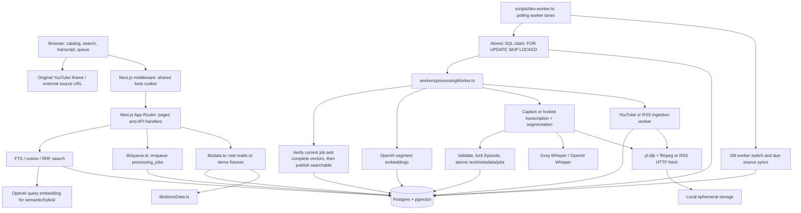
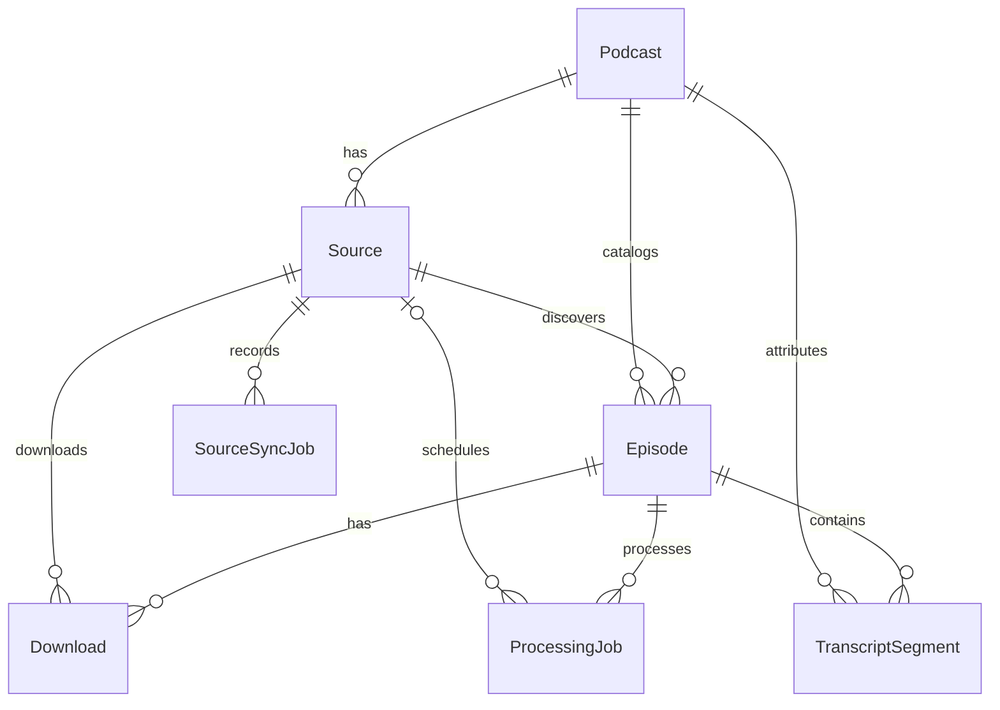

# Podchives architecture

Verified repository baseline: `cf83fa6`, audited 2026-10-09; updated through autonomous M3 embedding/indexing publication (2026-10-10). This describes code and deployment intent, not deployed infrastructure. Remaining proposed decisions require approval.

## Current system

## Web application and routes

The root redirects to `/dashboard`. The `(dashboard)` layout applies the app shell and `force-dynamic`; its pages are request-rendered, even where a child lacks that flag. `/login` and the not-found page are separate. React server components read `lib/data.ts`; client components use JSON routes for mutations and polling. URL parameters drive episode/search filters. There is no separate Express/FastAPI service.

Pages: `/dashboard`, `/search`, `/advanced-search` (redirect), `/archives`, `/episodes`, `/episodes/[id]`, `/sources`, `/download-manager`, `/processing-queue`, `/usage`, `/settings`.

| API | Current responsibility |
| --- | --- |
| `POST /api/auth/login`, `POST /api/auth/logout` | Shared-password cookie issuance/clear; Edge runtime |
| `GET/POST /api/sources` | Source list/create and initial discovery enqueue |
| `DELETE /api/sources/[id]` | Remove source, cascaded episode data, possibly empty archive |
| `POST /api/sources/[id]/sync` | Enqueue source discovery unconditionally |
| `POST /api/sources/[id]/stop-sync` | Disable auto-sync, mark queued work failed, set source idle |
| `POST /api/sources/[id]/auto-sync`, `POST /api/sources/auto-sync` | Per-source/global toggles over Source rows |
| `GET /api/episodes`, `GET /api/episodes/[id]` | Catalog and episode/segment data |
| `GET /api/transcripts/[episodeId]` | Ordered segments |
| `GET /api/search` | Keyword default; semantic/hybrid optional; filters and analytics |
| `GET /api/downloads` | Latest 200 raw Download rows |
| `GET /api/processing-jobs` | Latest 100 jobs, optional status |
| `POST /api/processing-jobs/[id]/retry` | Requeue an ID without a failed-status precondition |
| `GET /api/processing-queue/live` | Active/queued/failed/completed buckets and counts |
| `GET/PATCH /api/worker` | Global DB worker-enabled flag and queue snapshot |
| `GET /api/dashboard/live`, `/api/dashboard/cockpit` | Small live summary and full dashboard recovery payload |
| `GET /api/usage`, `/api/usage/backfill`, `/api/usage/full` | Usage estimate and backlog estimates |

API handlers are protected through middleware when `BETA_PASSWORD` is set; there are no per-resource ownership checks. List/error handling varies: `lib/data.ts` commonly logs and returns an empty list/zero object, while direct Prisma routes can throw. Search errors become HTTP 200 with no matches through `runSearch`.

Dashboard/catalog caching uses memory and sessionStorage and can retain expired data. SearchResultsView now clears prior hits and fetches no-store, without restoring cached search results. The unused searchCache module remains for a future deliberate freshness design. The Next config still sets experimental route `staleTimes` to 1800s. An already displayed response is a retrieval snapshot; no cross-client invalidation/polling is implemented. Cache freshness and authorization scope need explicit design before multi-user use.

## Persistence model

`SearchQuery`, `WorkerRun`, `SchedulerSettings`, and `User` are independent tables. `User` is not related to archives or sessions. There is no Workspace, Organization, membership, Transcript version, SavedClip, Moment, Claim, Contradiction, subscription, or usage ledger model.

Important constraints: Podcast slug is globally unique; Episode is unique on `(sourceId, externalId)`; transcript segments have separate Podcast and Episode foreign keys. These foreign keys do not enforce that a segment's podcast equals its episode's podcast, or that an episode's podcast equals its source's podcast. Sources have no canonical identifier or URL uniqueness constraint. Segment start/end/confidence/status fields lack database checks. Statuses and types are Strings, not enums.

Prisma manages ordinary relations. `transcript_embedding` is `Unsupported("vector(1536)")?`; raw SQL writes and searches it. Schema extension declaration requires pgvector. No checked-in Prisma migration chain exists; ad hoc ALTER scripts add auto-sync, worker-enabled, and usage columns. The GIN/HNSW indexes are created by `scripts/create-search-indexes.ts`, not `prisma generate`, normal worker indexing, or an automatic deploy migration.

## Real ingestion and processing

1. Source creation derives a name/slug, upserts Podcast, inserts Source, then creates a `source_sync` job. These are separate writes.
2. `runSourceSyncJob` dispatches by Source type/RSS URL heuristic. YouTube single-video uses `--no-playlist --dump-single-json`; channel/playlist uses `--flat-playlist --dump-json` plus a channel-profile request. Profile request failure is tolerated. Flat entries are not individually enriched.
3. Each discovery item is upserted into Episode. Processing admission serializes per-source queued/inflight limits under Source then Episode locks; ingest loops also observe per-sync admission caps. These caps bound queued pipelines, not discovery catalog size. Auto-sync off leaves deferred episodes waiting for manual sync.
4. Initial step is thumbnail cache if applicable, otherwise transcript if cheap transcript access is expected, otherwise download. The nominal sequence is `thumbnail_cache → download → audio_extract → transcription → transcript_segmentation → embedding → indexing`; succeeding jobs enqueue one next step, with bypasses.
5. Default YouTube backend skips audio, retrieves English VTT, validates cue/inline timing and decodes entities once. Explicit inline spans preserve fractional boundaries. YouTube dedup only removes identical explicit start/end/text from overlapping cues; untimed or otherwise ambiguous repeats remain. Generic RSS VTT does not opt into deduplication. Hosted transcription uses Groq `whisper-large-v3-turbo` or OpenAI `whisper-1`, via `verbose_json` segment timestamps. Audio larger than 24 MiB is re-encoded/chunked with ffmpeg and timing is shifted by nominal chunk offsets.
6. If cheap transcript access fails without audio, the transcription job fails and queues a real audio download. The download checks historical failed transcription so its caption fast path does not skip again. On success a fresh transcription job is eligible. This path exists; real retries and worker races are not verified.
7. `saveTranscriptSegments` validates raw/packed datasets and attribution/duration (two-second known-duration tolerance). One transaction locks Episode, checks the previous ID snapshot, replaces text and vectors, updates metadata, supersedes downstream jobs, queues segmentation/embedding and completes the current transcription/segmentation job. Valid overlaps/repeats survive; packing retains maximum ends. Original cues are still replaced by ~30s chunks (60s merge threshold); provider response/word timing/model/language/version are not durably retained. Long individual cues are not forcibly split.
8. Embedding batches of 64 call `text-embedding-3-small`; writes require 1536 finite values and one matching row. Worker publication locks Episode and checks the original segment IDs, current embedding job and full vector coverage before setting isEmbedded, completing that job and admitting/reusing one current indexing successor in the same transaction. The query still fetches **all** segments, so retry repeats successful API work. Failure leaves valid text stored and search pending.
9. Queue SQL allows indexing once isEmbedded is true. The handler locks Episode and verifies the current job is not superseded, transcript/embedding flags and complete vector coverage before setting isSearchable/processing completed and completing the indexing job in that same transaction. It does not create or verify installed search indexes.

## Queue and scheduler semantics

Claims use a single atomic UPDATE around a subselect with `FOR UPDATE SKIP LOCKED` and dependency predicates. Source sync has highest claim priority, then indexing/embedding/segmentation/transcription/extraction/download; thumbnail cache has lowest priority. Transcription/segmentation completion and successor enqueue now commit with transcript replacement. Embedding → indexing and final indexing completion now commit atomically with readiness, with successful repeat completion idempotent. Media-stage handoffs now use queueTransitions to transact successor lookup/create and predecessor completion, sharing the Episode lock with maintenance enqueue and media failure/cancellation. Repeated success is a no-op and inactive completions are skipped. Initial episode admission now locks Source then Episode to check source pressure and active jobs before creating one resume job. Resume prioritizes transcript/stage/vector readiness, then local regular/readable/nonempty files. Source-sync/audio-fallback admission remains separate. External media/artifact work remains outside these transactions. Superseded transcript jobs use the existing completed-with-error convention; their workers return skipped without cancelling the new generation. Transcript-job failure/cancellation also locks Episode and rechecks supersession before cancelling queued work. This is bounded generation protection, not a durable lease/version system.

The continuous runner starts N lanes, each calling `processOnce` repeatedly until eligible work runs out. It writes a WorkerRun for each drain batch; stdout and concatenated job outcomes form the log. Failed jobs do not automatically retry in this runner. It checks the global worker flag before a batch, reclaims stale inflight jobs every five minutes using a 45-minute `updatedAt` cutoff, and checks source auto-sync at most once a minute between batches. Raw claim does not update `updated_at`. No heartbeat, lease token, deadline, exponential backoff, dead-letter queue, or retry budget for stale reclaims exists.

`workers/scheduler.ts` is a separate entry point. `runOnce` requeues failed rows with retryCount < 3 and drains `MAX_JOBS_PER_RUN` jobs. It ignores `workerEnabled`, retries user-stopped rows, and reads env options rather than the available unused DB settings loader. Daemon scheduling uses host-local time. `PROCESSING_MODE` is descriptive configuration; it does not select a runner. `OVERNIGHT_*` and `MAX_JOBS_PER_RUN` do not bound the continuous runner.

## Retrieval and playback

Keyword search uses English `to_tsvector`, `websearch_to_tsquery`, and `ts_rank`. Semantic search embeds the query and orders by pgvector cosine distance. Hybrid runs both in parallel and uses reciprocal rank fusion with k=60. Archive/platform/date constraints are parameter-bound; numeric limit is interpolated after coercion. The API clamps only the upper limit, so negative inputs are not properly validated.

Results join Episode and Podcast for attribution, include source URL/platform, publish date, start/end and quoted text. Display scores are normalized relative to the strongest hit, not accuracy probabilities. Default filters require isSearchable, still dependent on embeddings even for keywords. Semantic SQL also requires isEmbedded/embeddingStatus completed regardless of searchableOnly. Replacement rows/vectors and existing expression/vector indexes obey PostgreSQL transaction visibility; no separate index rebuild job is needed. Query analytics is best-effort and can be written on empty requests.

Transcript highlights in search, episode view and dashboard are React text/mark children; external transcript/query strings are never inserted as HTML. Regression tests inspect React server-rendered markup, while browser interaction remains unverified.

The browser plays the original YouTube source, not worker disk files. The iframe has `enablejsapi=1&start=N`, with seek/play postMessages; current-time messages have no origin/frame verification and no explicit player-ready handshake. External timestamp URL generation is implemented. RSS playback in-app is missing.

## Deployment and storage

- Repository intent: deploy the web on Vercel, worker on Render, database on Supabase. No active deployments or platform API state were queried. Settings labels are not evidence of deployment.
- `render.yaml`: Docker background worker, `branch: main`, auto-deploy enabled, continuous `npm run worker`, concurrency 10, caps up to 300 queued admissions/source and 50 inflight. This is capacity configuration, not tested throughput. No persistent disk is declared. Plan/price comments are historical and were not verified.
- Docker: Node 20 slim; ffmpeg/python/curl/unzip; downloads latest yt-dlp; installs curl-cffi; downloads Deno through its installer. Build uses dev deps, generates Prisma and typechecks; runtime uses production deps, including `tsx`. It does not build or start the web. Unpinned system downloads reduce reproducibility; curl-cffi/EJS behavior in this image needs a real container check.
- `lib/db.ts` lazy singleton adds `connection_limit=1` and `pgbouncer=true` for port 6543. Prior docs recommend a transaction pooler for web and a session/direct connection for workers. Actual service URLs/connection limits are unverified. Worker DB writes are effectively serialized by the single Prisma connection even with concurrent provider work.
- Files go to `storage/{audio,video,thumbnails,transcripts}`. Media and writable cookie jars are ephemeral. `STORAGE_BUCKET` is unused. Absolute media paths persist in DB across redeploys and across worker instances, so path presence does not prove file availability. Cached thumbnails are not served; browser uses CDN URLs. There is no media retention or cleanup policy.
- `.dockerignore` excludes `.env` and `.env.local` but not every `.env.*.local` pattern used by `.gitignore`; review build contexts before publishing images. No image was built here.

## Proposed architecture decisions

| Decision | Rationale and boundary |
| --- | --- |
| Retain Next.js, Prisma/Postgres, pgvector and existing workers | Enough of the immediate pipeline exists to fix and verify incrementally. No framework or queue replacement needed now. |
| Transactional transcript writes and readiness guards | Implemented in Milestone 1; 47 unit + 12 real PostgreSQL cases passed in 1B, including rollback and two-session lock contention. No application migration or new framework. |
| Follow with atomic job handoffs, serialized enqueue, lease/heartbeat semantics | Make existing queue recoverable before tuning throughput. Use Postgres locking/transactions initially. |
| Treat keyword readiness separately from semantic readiness | Proposed later behavior: valid transcripts can support FTS during embedding failure; expose retrieval availability honestly. Requires approval and migration/state review. |
| Preserve raw/versioned transcripts separately from retrieval chunks | Context windows, exact clip timing, provider audit and regeneration require stable source evidence. Additive design after pipeline verification. |
| Canonical media identity scoped to workspace; source associations separate | Avoid duplicate episodes across channel/playlist/video sources without losing attribution. Requires planned additive migration/backfill. |
| Separate identity/isolation from beta gate before multi-user release | Workspace membership, server authorization, scoped queries/jobs/caches; evaluate RLS only with verified tenant context. |
| Object storage for durable artifacts; local disk for job scratch | Enables redeploy recovery, uploads and exports; select provider after requirements, not during this audit. |
| Context discovery and contradictions reference immutable evidence | Store time spans, neighboring context, transcript version, speaker/entity identity, confidence and review state; do not infer contradiction from opposite-sounding snippets alone. |

Milestone 1 is implemented and its bounded real-database acceptance cases passed in 1B. `scripts/test-transcript-postgres.mjs` provisions/removes an isolated native cluster for reproducible verification; it does not change deployment architecture. Other decisions remain proposals. Architecture preservation is the baseline; schema changes need a reviewed migration strategy.

Queue control continuation: queueControl transacts Source-locked source sync admission/queued metadata and Episode-locked generation-checked fallback failure/download admission. Source stop transacts queued cancellation under Source lock. Claim SQL checks scheduler pause and cancellation markers each time. No new service or migration; running attempts remain outside these admission guarantees.

Cancellation continuation: jobControl.withActiveJob provides short Source/Episode-locked database publication callbacks; never put provider/media work inside them. Stop locks Source → Episodes (ordered IDs) before cancelling running/queued records. Source-worker episode admission passes sourceJobId. Explicit retry uses a fresh processing-job ID and supersedes the old ID under those same locks. Automatic reclaim/retry still lacks attempt tokens.
